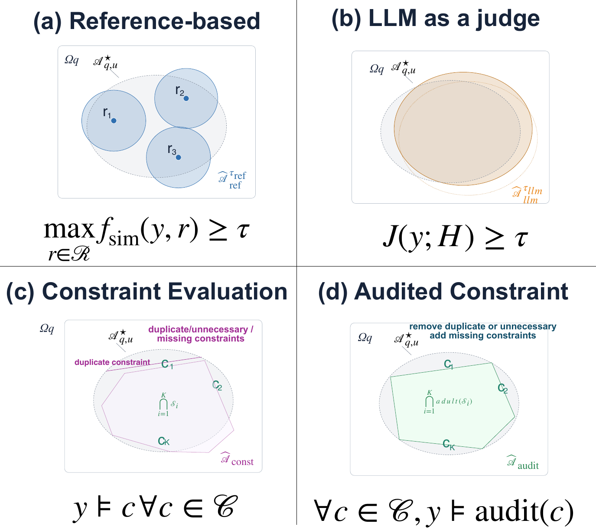
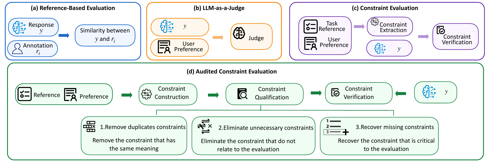
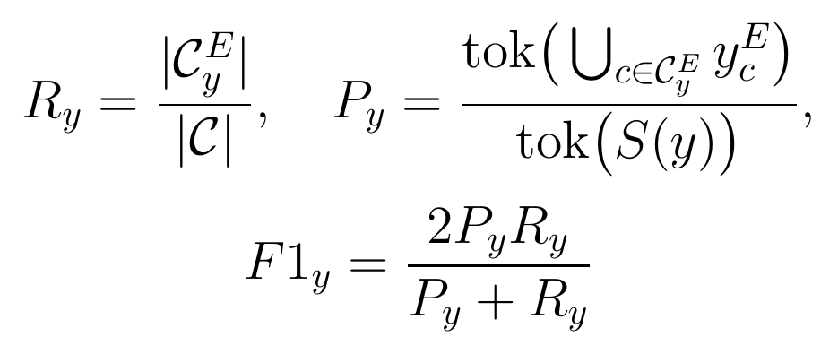
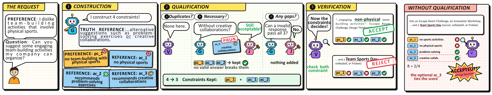

# ConQual-Audit

**Neither Over- nor Under-Constrained: Evaluating LLM Personalization under a Constraint Qualification Audit**

LLM personalization refers to tailoring LLM outputs to both task-grounded reference and user-specific preferences. ConQual-Audit is an audit-based framework that evaluates LLM personalization through a 3-stage process: (1) extracting semantic constraints from user profiles and task-grounded reference; (2) **qualifying constraints by pruning unnecessary constraints and recovering missing constraints**; (3) verifying candidate responses against the audited constraints via natural language inference. 

---

## Motivation problem: where is the decision boundary for valid personalised responses?

<p align="center">
  
</p>

For a query *q* and user *u*, each box is the space of all possible responses Ω<sub>q</sub>. The grey ellipse inside
it, 𝒜<sup>⋆</sup><sub>q,u</sub>, holds the responses that are truly valid. The coloured shape is the region an
evaluator induces. Whatever it accepts outside the ellipse is a false acceptance, and whatever it misses inside the
ellipse is a false rejection.

| | Paradigm | Accepts a response when… | What goes wrong |
|---|---|---|---|
| (a) | Reference-based metrics (e.g., BLEU, ROUGE, BERTScore, MoverScore) | it is similar enough to a human annotations | Valid paraphrases fall outside the balls; a negated answer ("*is not* X") looks almost identical to the reference |
| (b) | LLM-as-a-judge paradigms(e.g., GEMBA, PerSE) | the score of the response is over the threshold  | The boundary is implicit and uncalibrated |
| (c) | Constraint evaluation (e.g., FActScore, ExPerT, PREF) | it satisfies every generated constraint | Unnecessary constraints shrink the region (**over-constrained**: false rejections); missing constraints enlarge it (**under-constrained**: false acceptances) |
| (d) | **Audited constraints (ConQual-Audit)** | it satisfies every *qualified* constraint | The audit removes duplicate and unnecessary constraints and adds missing ones, so the region fits 𝒜<sup>⋆</sup> |

## How ConQual-Audit works

<p align="center">
  
</p>

ConQual-Audit requires three roles: the generator **G**, the verifier **V** and the judge **J**.

1. **Constraint Construction:** Generate *preference constraints* from user's history and *answer constraints* from task references.

2. **Constraint Qualification (the audit):** *Remove duplicates. *Eliminate unnecessary constraints.*  *Recover missing constraints.*
   
3. **Constraint Verification.** Evaluate the response with audited constraints

Measurement Result: constraint coverage, response attribution, and their harmonic mean. 
<p align="center">
  
</p>

## Case study example

<p align="center">
  
</p>

The user preference is **dislikes team-building activities that involve physical sports**. 

The task reference if for non-physical alternatives such as **problem-solving exercises** or **creative collaborations**.

**Constraint Construction**
- Generate 4 constraints: `pc_1` (no physical team-building),
- `ac_1` (no physical sports), `ac_2`
- (problem-solving exercises)
- `ac_3` (creative collaborations).

**Constraint Qualification** 
- Find no duplicate. 
- Prune `ac_3`: an answer without creative collaborations is still acceptable.
- Find no missing constraint.

**Verification** with `pc_1`, `ac_1` and `ac_2` accepts  and **rejects** the negative one, which
- The positive answer is accepted with audited constraints (`pc_1`, `ac_1` and `ac_2`)
- The negative answer is rejected with audited constraints (`pc_1`, `ac_1` and `ac_2`)

**Without qualification**, 
- The negative answer gets `ac_2` and `ac_3` satisfied and is **accepted**. That is the wrong decision.


## Results

Evaluators judge controlled positive responses (same meaning with *Golden Labels*) and negative responses (different meanings with *Golden Labels*). Across PrefEval and LaMP, ConQual-Audit outperforms nine baselines, attaining top AUCs (0.88 and 0.90) and the lowest false rate (0.21) on the leanest constraint sets at an amortizable audit cost. Crucially, this constraint audit is portable: integrating it into ExPerT and PREF helps revise smaller, higher-quality constraint sets to reduce their evaluation false rates.

---

## Repository layout

```
conqual/audit.py              ConQual-Audit: construction, qualification, verification, R / P / F1
benchmarks/                   test sets, what each evaluator is shown, and each dataset's prompts
  prefeval.py lamp1.py lamp2.py lamp4.py
  build_prefeval.py           select the 100 PrefEval items and generate the Qwen3-14B responses
  build_lamp.py               build the controlled LaMP-1 / -2 / -4 test sets from the official LaMP files
baselines/                    BLEU-4 / ROUGE-L, BERTScore / MoverScore, GEMBA, FActScore, ExPerT, PREF, PerSE
experiments/
  run_conqual.py              ConQual-Audit on a benchmark
  audit_baselines.py          ExPerT / PREF constraints audited by ConQual, then re-scored by each method
tables/                       the paper's tables from the saved results (no GPU needed)
utils/                        judge model and JSON parsing (llm.py), batched runs with checkpoints (runner.py)
data/prefeval/                the PrefEval test responses used in the paper
assets/                       the figures of this README
```

## Setup

```bash
pip install -r requirements.txt        # Python >= 3.10; the paper's runs used one NVIDIA H100 NVL
```

**PrefEval.** `data/prefeval/` holds the 100 selected items (5 per topic) of
[PrefEval](https://huggingface.co/datasets/siyanzhao/prefeval_explicit) and the Qwen3-14B responses used in the paper:
positive = the answer after the user stated the preference, negative = the answer without it.
`python -m benchmarks.build_prefeval` regenerates them. Greedy generation can differ slightly across hardware.

**LaMP.** Download the [LaMP](https://lamp-benchmark.github.io/download) files:

- LaMP-1: `dev_questions.json` and `dev_outputs.json` (its test outputs are not public);
- LaMP-2 and LaMP-4: `test_questions.json` and `test_outputs.json`.

Then build each test set. Each has 100 users, and each query has 30 responses: 10 positives, 10 wrong answers and 10
negated answers.

```bash
python -m benchmarks.build_lamp --dataset lamp4 --questions <LaMP-4>/test_questions.json --answers <LaMP-4>/test_outputs.json
```

## Reproducing the paper

```bash
bash scripts/run_prefeval.sh cuda:0     # all PrefEval runs, then Tables 2-3 and the Figure 3 case
bash scripts/run_lamp.sh cuda:0         # all LaMP-1/2/4 runs, then Table 1
```

Each step writes `results/<dataset>/<step>_<tag>.json`, with one record per response: score, details, time and tokens.
Runs are checkpointed, so `--resume` continues an interrupted run, and `--max-users N` makes a quick test.

| Paper | Script | Source runs |
|---|---|---|
| Table 1 (LaMP average) | `python -m tables.lamp` | `baselines.*`, `experiments.run_conqual` on lamp1/2/4 |
| Table 2 (PrefEval) | `python -m tables.prefeval` | `baselines.*`, `experiments.run_conqual`, `experiments.audit_baselines` |
| Table 3 and the "removed only" counterfactual | `python -m tables.prefeval` | `experiments.audit_baselines` |
| Cost numbers in §5 and the Limitations | `python -m tables.prefeval` | `run_conqual`, `ablation`, `audit_baselines` |
| Figure 3 (case study) | `python -m tables.case_study --query prefeval_0594::q1` | `run_conqual`, `ablation` |

How the tables are computed (`tables/common.py`):

- **Two-part scores.** GEMBA (GEMBA-DA with the reference), PerSE, FActScore and ExPerT score the reference and the
  preference separately. A positive response gets the lower part and a negative response the higher one, so it must
  pass or fail both.
- **Analysis set.** Methods that scored at least 80% of every response kind are compared on the responses all of them
  scored.
- **Tokens.** End to end per response: online plus the one-off setup.
- **#Cons.** The number of constraints a response is checked against.

## Using ConQual-Audit

```python
from benchmarks import prefeval
from conqual import ConQualAudit
from utils.llm import load_model

tokenizer, model = load_model("Qwen/Qwen3-8B", "cuda:0")
audit = ConQualAudit(tokenizer, model, prefeval.CONQUAL_PROMPTS)
metrics, verification, qualified, constructed = audit.evaluate(
    query, response, reference,
    user_profile=[{"preference": "I dislike team-building activities that involve physical sports."}])
print(metrics["R"], metrics["P"], metrics["f1_score"])
```

For many responses to the same query, call `audit.build_constraints(...)` once and `audit.verify_constraints(...)` for
each response.
